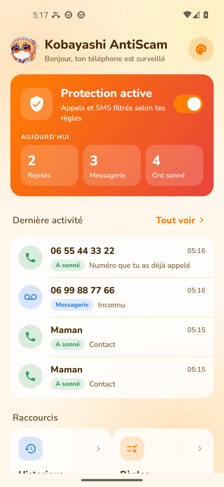
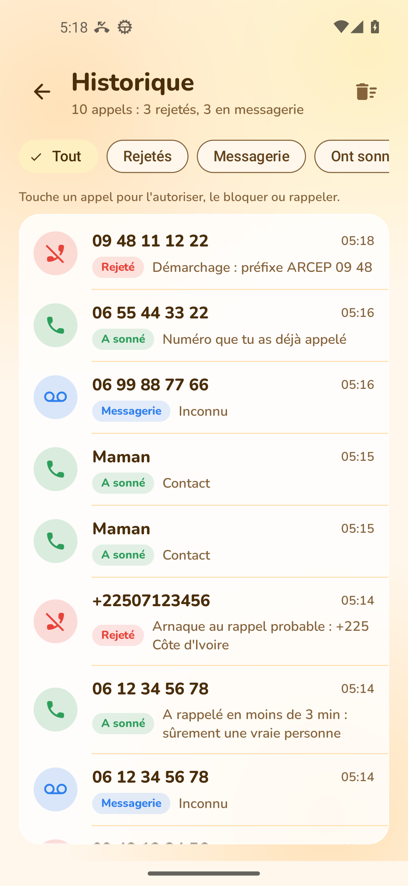

<!--
FICHIER : README.md | CHEMIN : D:/Kobayashi/Developpement/shield/README.md | LIGNES : 95
RÔLE : Page d'accueil du dépôt GitHub | DATE : 2026-10-16 | VERSION : 1.7.0 | ORIGINE : Réécriture
AUTEUR : Maitre Kobayashi | STATUT : STABLE | DÉPENDANCES : docs/ | LIEN : CHANGELOG.md
NOTES : en-tête en commentaire HTML pour rester invisible sur GitHub
-->

<p align="center">
  
</p>

<h1 align="center">Kobayashi AntiScam</h1>

<p align="center">
  Filtre d'appels et de SMS pour Android, pensé pour Free Mobile.<br>
  Les démarcheurs sont rejetés, les inconnus partent en messagerie, tes proches et ton travail sonnent normalement.
</p>

<p align="center">
  
  
  
</p>

<p align="center">
  
  &nbsp;&nbsp;
  
</p>

## Ce que fait l'application

Chaque appel entrant passe par une suite de règles, dans cet ordre. La première qui s'applique décide, et sa raison est écrite dans l'historique.

| Situation | Résultat |
|---|---|
| Protection coupée | Sonne |
| Règle que tu as créée | Ce que dit la règle |
| Contact du téléphone | Sonne, avec son nom dans l'historique |
| Liste blanche | Sonne |
| Numéro que tu as déjà appelé | Sonne (patrons, collègues, livreurs rappelés) |
| Préfixe de démarchage ARCEP (09 48, 01 62, 03 77...) | Rejeté |
| Même inconnu qui rappelle en moins de 3 minutes | Sonne, c'est sûrement une vraie personne |
| Pays connus pour l'arnaque au rappel (+225, +223, +243...) | Rejeté |
| Plus de 5 numéros différents d'une même tranche en 24 h | Rejeté (rotation de numéros) |
| Inconnu ou numéro masqué | Messagerie, sans sonner |

Un inconnu n'est jamais rejeté sur un simple soupçon : il arrive sur ta messagerie Free et peut laisser un message. Depuis l'historique, un appui sur la ligne permet de l'autoriser, de le bloquer ou de le rappeler.

Côté SMS, la notification des expéditeurs bloqués par une règle est masquée. Le message reste lisible dans l'application Messages, car Android réserve le blocage réel à l'application SMS par défaut. Le désarmement des liens et le signalement au 33700 sont prévus.

## Installation

1. Télécharger `app-debug.apk` depuis la [dernière release](https://github.com/MaitreKoba/KobaAntiScam/releases/latest).
2. L'installer en autorisant les sources inconnues.
3. Dans l'application, ouvrir Réglages et accorder le rôle de filtrage d'appels, l'accès aux notifications et l'exclusion de l'optimisation batterie (indispensable sur Honor).

Les versions suivantes s'installent depuis l'application : Accueil, puis Mise à jour.

## Annonce personnalisée

Une application Android ne peut pas diffuser de son dans un appel téléphonique. Pour que l'appelant entende ton message, il faut le mettre en annonce d'accueil de la messagerie Free : espace abonné, Messagerie vocale, envoi d'un fichier audio (45 secondes et 2 Mo au maximum). Tous les appels envoyés en messagerie par l'application l'entendront.

## Données personnelles

L'historique, la liste blanche et les règles restent sur le téléphone. Aucune donnée n'est envoyée ailleurs, à part la vérification des mises à jour auprès de GitHub.

## Développement

```bash
./gradlew assembleDebug          # compiler
./gradlew testDebugUnitTest      # tests unitaires
adb install -r app/build/outputs/apk/debug/app-debug.apk
adb logcat -s Shield             # verdict de chaque appel
```

Le moteur de décision est dans `app/src/main/java/fr/kobayashi/shield/model/Decision.kt`. L'historique des versions est dans [CHANGELOG.md](CHANGELOG.md).
